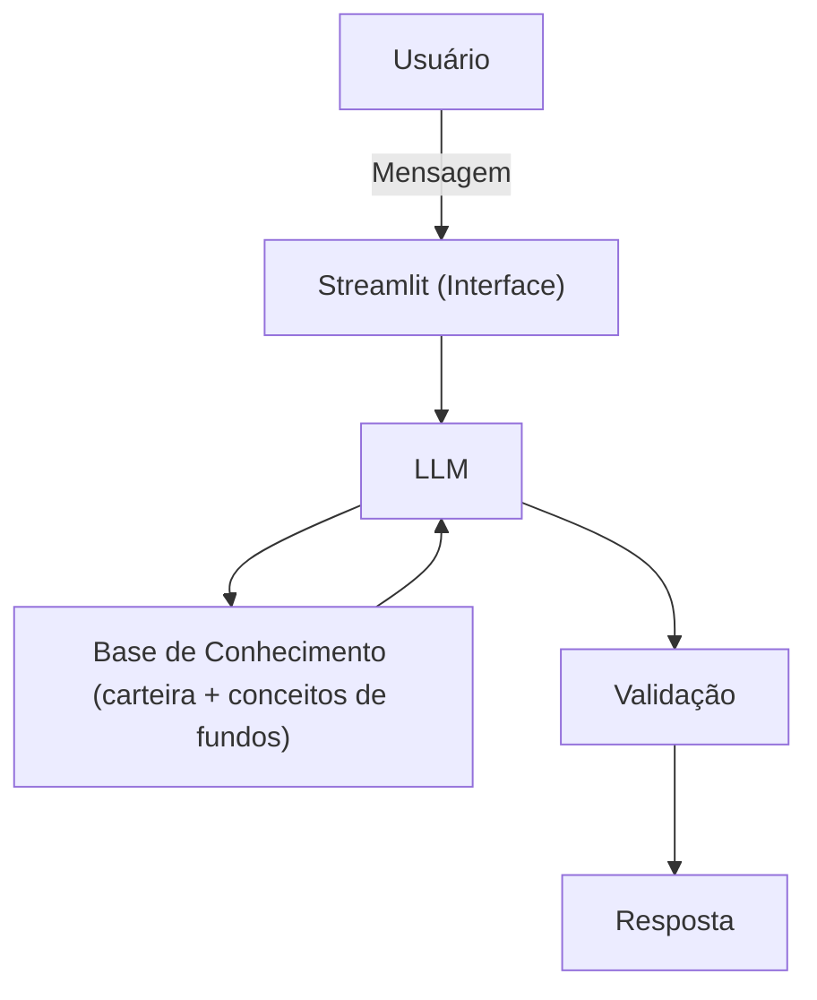

# 🎓 Smith: Educador Financeiro de Fundos de Investimento

> Agente de IA Generativa que ensina o investidor a entender a própria carteira de fundos: taxas, come-cotas, IR e prazos de resgate, explicados com os números dele.

Projeto desenvolvido no Lab **"Construa Seu Assistente Virtual Com Inteligência Artificial"** da [DIO](https://www.dio.me/), na trilha Bradesco de Dados, Cibersegurança e GenAI.

---

## 💡 O Problema

Muitos investidores aplicam em fundos sem entender os custos e as regras que afetam seu dinheiro. Taxa de administração, taxa de performance, come-cotas, IR regressivo e prazo de resgate (D+X) estão nas lâminas dos fundos, mas em linguagem técnica. O investidor só percebe o impacto quando ele já aconteceu: rendimento abaixo do esperado, resgate que demora semanas ou imposto que ele não previa.

## 🤖 A Solução

O **Smith**, nome em referência a Adam Smith, considerado o pai da economia moderna, é um educador financeiro especializado em fundos. Em vez de esperar perguntas, ele **analisa a carteira do usuário e aponta proativamente** o que merece atenção:

| Situação na carteira | O que o Smith faz |
|----------------------|-------------------|
| Fundo DI com taxa de administração de 1,5% | Explica quanto a taxa custa em reais e por que o fundo rende menos que o CDI |
| Fundo com resgate D+30 usado como reserva de emergência | Explica cotização e liquidação, e por que o prazo não combina com o objetivo |
| Come-cotas no fim do mês | Explica por que a quantidade de cotas vai diminuir |
| Fundo de ações abaixo do valor aplicado | Explica risco e tributação de fundos de ações |

O Smith **educa, não aconselha**: ele não recomenda comprar, vender ou trocar fundos. Seu papel é fazer o usuário entender o que tem para decidir por conta própria.

---

## 🏗️ Arquitetura



| Componente | Tecnologia |
|------------|------------|
| Interface | Streamlit |
| LLM | Ollama (modelo local) |
| Base de Conhecimento | JSON e CSV com dados fictícios |
| Dados e cálculos | Python + Pandas |

---

## 📂 Base de Conhecimento

Todos os dados são **fictícios** e ficam na pasta [`data/`](./data/):

| Arquivo | Conteúdo |
|---------|----------|
| [`perfil_investidor.json`](./data/perfil_investidor.json) | Perfil, objetivo e metas do cliente fictício |
| [`carteira_fundos.json`](./data/carteira_fundos.json) | Fundos do cliente: taxas, prazos de resgate, datas e valores |
| [`conceitos_fundos.json`](./data/conceitos_fundos.json) | Explicações dos conceitos de fundos usadas pelo Smith |
| [`historico_atendimento.csv`](./data/historico_atendimento.csv) | Dúvidas anteriores do cliente sobre fundos |

---

## 🛡️ Segurança e Anti-Alucinação

- Responde apenas com base nos dados fornecidos
- Cálculos (dias de aplicação, faixa de IR, custo das taxas) são feitos em Python, não pelo LLM
- Admite quando não sabe e indica onde encontrar a informação
- Não faz recomendação de investimento e não usa dados reais

---

## 📋 Etapas do Projeto

| Etapa | Documento | Status |
|-------|-----------|--------|
| 1. Documentação do Agente | [`docs/01-documentacao-agente.md`](./docs/01-documentacao-agente.md) | ✅ Concluída |
| 2. Base de Conhecimento | [`docs/02-base-conhecimento.md`](./docs/02-base-conhecimento.md) | ✅ Concluída |
| 3. Prompts do Agente | [`docs/03-prompts.md`](./docs/03-prompts.md) | ✅ Concluída |
| 4. Aplicação Funcional | [`src/`](./src/) | ✅ Concluída |
| 5. Avaliação e Métricas | [`docs/04-metricas.md`](./docs/04-metricas.md) | ✅ Concluída |
| 6. Pitch | [`docs/05-pitch.md`](./docs/05-pitch.md) | ✅ Concluída |

---

## 🗂️ Estrutura do Repositório

```
📁 dio-lab-bia-do-futuro/
├── 📄 README.md
├── 📁 data/        # Base de conhecimento (dados fictícios)
├── 📁 docs/        # Documentação de cada etapa
├── 📁 src/         # Código da aplicação
├── 📁 assets/      # Imagens e diagramas
└── 📁 examples/    # Referências do desafio
```

---

## ⚠️ Aviso

Este é um projeto educacional. O Smith não oferece recomendação de investimento e não substitui um profissional certificado. Todos os dados são fictícios.

---

## 👤 Autor

**Fernando Monteiro**
[GitHub](https://github.com/fernando-a-monteiro)